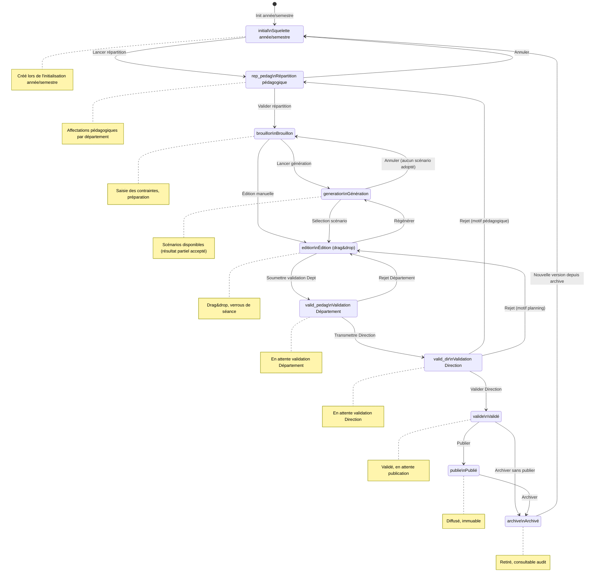

# WORKFLOW_METIER.md

**Projet :** TAKT — Application de planification et de gestion des emplois du temps pédagogiques  
**Licence :** GNU AGPL v3  
**Statut :** Phase 0 (E0.2) — Validé  
**Date :** 30 octobre 2026

---

## 1. Objet

Ce document définit le cycle de vie complet d'une version d'emploi du temps (EDT), les transitions autorisées, les règles de garde (qui peut faire quoi, quand, et sous quelles conditions), ainsi que les responsabilités par rôle et par état.

Il constitue le **E0.2** de la Phase 0 du PLAN MACRO. Il conditionne le modèle de données, les guards de sécurité, le solver de génération, les exports et les tests.

---

## 2. États d'une version d'EDT

| Code | Libellé | Description | Origine |
|------|---------|-------------|---------|
| `initial` | Squelette année/semestre | Squelette créé lors de l'initialisation de l'année/semestre | Création système |
| `rep_pedag` | Répartition pédagogique | Alimentée par la répartition pédagogique ; validée par le Resp. Département → passe à `brouillon` | Répartition pédagogique |
| `brouillon` | Brouillon | Provenant d'une `rep_pedag` validée ; saisie des contraintes en cours | `rep_pedag` validée |
| `generation` | Génération | Une génération automatique est en cours ou vient de s'achever. Des scénarios sont disponibles. | `brouillon` ou `edition` |
| `edition` | Édition | Drag&drop, verrous ; provient de `generation` ou directement de `brouillon` ; passe à `valid_pedag` ou peut revenir à `generation` | `generation` ou `brouillon` |
| `valid_pedag` | Validation Département | Version `edition` soumise par le Gestionnaire pour validation du Responsable Département | `edition` |
| `valid_dir` | Validation Direction | La Direction valide → `valide`, ou rejette → `rep_pedag` ou `edition` selon le motif de refus | `valid_pedag` |
| `valide` | Validé | Une version validée par la Direction et en attente de publication par le Gestionnaire | `valid_dir` |
| `publie` | Publié | La version est diffusée (exports, notifications). Elle est immuable. | `valide` |
| `archive` | Archivé | La version est retirée de la diffusion active mais reste consultable pour l'audit. | `publie` ou `valide` |

---

## 3. Matrice des transitions autorisées

| État source | État cible | Déclencheur | Rôle autorisé | Condition de garde |
|-------------|------------|-------------|---------------|-------------------|
| `initial` | `rep_pedag` | Lancer répartition pédagogique | Resp. Département | Année/semestre initialisée |
| `rep_pedag` | `initial` | Annuler répartition | Resp. Département | Aucune affectation validée |
| `rep_pedag` | `brouillon` | Valider répartition | Resp. Département | Répartition pédagogique validée sur son périmètre |
| `brouillon` | `generation` | Lancer génération | Gestionnaire | Contraintes saisies, aucun verrou bloquant |
| `brouillon` | `edition` | Édition manuelle directe | Gestionnaire | Aucune (saisie libre) |
| `generation` | `edition` | Sélection scénario | Gestionnaire | ≥ 1 scénario généré (ou partiel avec avertissements) |
| `generation` | `brouillon` | Annuler génération | Gestionnaire | Aucun scénario n'a été adopté |
| `edition` | `valid_pedag` | Soumettre validation Département | Gestionnaire | Verrous résolus, aucun conflit dur non résolu |
| `edition` | `generation` | Régénérer | Gestionnaire | Nouveau snapshot des données pédagogiques |
| `valid_pedag` | `valid_dir` | Transmettre à la Direction | Resp. Département | Validation départementale effectuée pour son périmètre |
| `valid_pedag` | `brouillon` | Rejet Département | Resp. Département | Motif de rejet fourni |
| `valid_dir` | `valide` | Valider définitivement | Direction | Tous départements concernés validés ; charge horaire OK |
| `valid_dir` | `rep_pedag` | Rejet Direction (motif pédagogique) | Direction | Motif de rejet lié à la répartition pédagogique |
| `valid_dir` | `edition` | Rejet Direction (motif planning) | Direction | Motif de rejet lié au planning seul |
| `valide` | `publie` | Publier | Gestionnaire | Version immuable à partir de cet instant |
| `valide` | `archive` | Archiver sans publier | Direction | Aucune diffusion |
| `publie` | `archive` | Archiver | Admin ou Gestionnaire | Ancienne version reste consultable |
| `archive` | `initial` | Nouvelle version depuis archive | Gestionnaire | Nouvelle version basée sur l'archivée ; l'originale reste archivée |

**Transitions interdites (toute autre combinaison) :**
- `publie` → tout état autre que `archive` (immutabilité)
- `archive` → `publie` (une version archivée ne peut pas être republiée directement)
- `valide` → `edition` (doit passer par `archive` puis nouvelle version depuis `initial`)
- `valid_dir` → `brouillon` (le rejet doit retourner à `rep_pedag` ou `edition`)

--- `ÉDITION` ou `GÉNÉRATION` |
| `REJETÉ` | `ÉDITION` | Corriger après rejet | Gestionnaire | Motif de rejet pris en compte |
| `REJETÉ` | `GÉNÉRATION` | Régénérer après rejet | Gestionnaire | Nouveau snapshot des données pédagogiques |
| `VALIDÉ` | `PUBLIÉ` | Publier | Direction ou Gestionnaire (délégation) | Version immuable à partir de cet instant |
| `VALIDÉ` | `ARCHIVÉ` | Archiver sans publier | Direction | Aucune diffusion |
| `PUBLIÉ` | `ARCHIVÉ` | Archiver | Admin ou Gestionnaire | L'ancienne version reste consultable |
| `ARCHIVÉ` | `BROUILLON` | Réouvrir comme nouveau brouillon | Gestionnaire | Crée une nouvelle version basée sur l'archivée ; l'originale reste archivée |

**Transitions interdites (toute autre combinaison) :**
- `PUBLIÉ` → tout état autre que `ARCHIVÉ` (immutabilité)
- `ARCHIVÉ` → `PUBLIÉ` (une version archivée ne peut pas être republiée directement)
- `EN_VALIDATION` → `PUBLIÉ` (doit passer par `VALIDÉ`)
- `BROUILLON` → `PRÊT_POUR_VALIDATION` (doit passer par `ÉDITION`)

## 4. Règles de garde détaillées

### Règle RB-WF-01 — Séparation des validations
La validation pédagogique (répartition enseignant ↔ module, niveau département) et la validation du planning (EDT, niveau Direction) sont distinctes et historisées. Une validation pédagogique ne vaut pas validation du planning.

### Règle RB-WF-02 — Revalidation ciblée
Lorsqu'une modification pédagogique impacte un département après sa validation initiale, seul ce département doit revalider. Les départements non impactés conservent leur validation.

### Règle RB-WF-03 — Pas de génération automatique
Le système ne lance jamais une génération automatiquement après une modification départementale. La génération est toujours déclenchée manuellement par le Gestionnaire.

### Règle RB-WF-04 — Sélection manuelle
La sélection finale d'un scénario généré est toujours manuelle. Le système ne choisit jamais seul une proposition.

### Règle RB-WF-05 — Immutabilité publiée
Une version `PUBLIÉ` est immuable. Toute modification crée une nouvelle version de travail (état `BROUILLON`) à partir de la précédente. L'ancienne version reste consultable en `ARCHIVÉ`.

### Règle RB-WF-06 — Verrouillage des séances
Pendant les états `ÉDITION`, `PRÊT_POUR_VALIDATION` et `EN_VALIDATION`, les séances peuvent être verrouillées (créneau, salle, enseignant, activité). Une séance verrouillée ne peut pas être déplacée par le solver lors d'une régénération.

### Règle RB-WF-07 — Résultats partiels
Une génération peut aboutir à des séances `NON_PLACÉE`. Elles sont marquées avec avertissement. La transition vers `ÉDITION` est autorisée, mais le gestionnaire doit résoudre les séances non placées avant de soumettre.

### Règle RB-WF-08 — Rejet Direction
Un rejet par la Direction (`EN_VALIDATION` → `REJETÉ`) doit systématiquement retourner la version vers `ÉDITION` (correction manuelle) ou `GÉNÉRATION` (régénération). Un rejet ne peut pas aboutir directement à `BROUILLON`.

---

## 5. Responsabilités par rôle et par état

| État | Admin | Gestionnaire | Resp. Département | Direction |
|------|-------|--------------|-------------------|-----------|
| `BROUILLON` | Consultation | CRUD complet | Affectation de son département | Consultation |
| `GÉNÉRATION` | Consultation | Lancer/suivre génération | Consultation | Consultation |
| `ÉDITION` | Consultation | Drag&drop, verrous | Affectation de son département | Consultation |

| `PRÊT_POUR_VALIDATION` | Consultation | Soumission | Validation de son périmètre | Consultation |
| `EN_VALIDATION` | Consultation | Consultation | Revalidation ciblée si impacté | Validation ou rejet |
| `REJETÉ` | Consultation | Correction | Correction de son périmètre | Motif de rejet |
| `VALIDÉ` | Consultation | Consultation | Consultation | Validation finale |
| `PUBLIÉ` | Consultation + Export | Export | Consultation | Consultation + Export officiel |
| `ARCHIVÉ` | Consultation + Audit | Consultation | Consultation | Consultation |

## 6. Relation entre répartition pédagogique et planning

| Étape | Acteur principal | Produit | État associé |
|-------|------------------|---------|--------------|
| Répartition pédagogique | Resp. Département | Affectations validées par département | Niveau département (indépendant de l'état EDT) |
| Préparation planification | Gestionnaire | Contraintes, vœux, exigences de salle | `BROUILLON` ou `ÉDITION` |
| Génération | Gestionnaire + Solver | Scénarios d'EDT | `GÉNÉRATION` |
| Sélection et édition | Gestionnaire | Scénario adopté, séances placées | `ÉDITION` |
| Validation département | Resp. Département | Validation de son périmètre | `PRÊT_POUR_VALIDATION` |
| Validation Direction | Direction | Validation finale de l'EDT | `EN_VALIDATION` → `VALIDÉ` |
| Publication | Direction / Gestionnaire | EDT diffusé | `PUBLIÉ` |
| Modification | Gestionnaire | Nouvelle version de travail | `BROUILLON` (nouvelle version) |

**Règle clé :** Une validation pédagogique (répartition) ne débloque pas automatiquement la génération. Le Gestionnaire décide du moment de lancer la génération sur la base des répartitions validées.

---

## 7. Verrous de séance pendant le workflow

| Type de verrou | Objet verrouillé | Effet pendant `ÉDITION` | Effet pendant génération |
|----------------|------------------|-------------------------|--------------------------|
| `CRÉNEAU` | Jour + créneau horaire | La séance ne peut pas changer de créneau | Le solver respecte le créneau (poids 100 %) |
| `SALLE` | Salle physique | La séance ne peut pas changer de salle | Le solver respecte la salle (poids 100 %) |
| `ENSEIGNANT` | Enseignant | La séance ne peut pas changer d'enseignant | Le solver respecte l'enseignant (poids 100 %) |
| `ACTIVITÉ` | Contenu de la séance | La matière/type ne peut pas changer | Le solver respecte l'activité (poids 100 %) |

**Conséquence :** Des verrous trop nombreux peuvent rendre une génération « Impossible ». Le système affiche un avertissement avant de lancer la génération si le taux de verrouillage dépasse un seuil configurable.

---

## 8. Notifications liées aux transitions de workflow

| Transition | Destinataire | Canal | Contenu |
|------------|--------------|-------|---------|
| `BROUILLON` → `GÉNÉRATION` | Gestionnaire | In-app + Email | Génération lancée / terminée |
| `ÉDITION` → `PRÊT_POUR_VALIDATION` | Resp. Département | In-app + Email | Version soumise pour validation |
| `PRÊT_POUR_VALIDATION` → `EN_VALIDATION` | Direction | In-app + Email | Version en validation finale |
| `EN_VALIDATION` → `VALIDÉ` | Gestionnaire + Resp. Département | In-app + Email | Version validée |
| `EN_VALIDATION` → `REJETÉ` | Gestionnaire | In-app + Email | Version rejetée avec motif |
| `VALIDÉ` → `PUBLIÉ` | Tous les utilisateurs concernés | In-app + Email + .ics | Version publiée, exports disponibles |
| `PUBLIÉ` → `ARCHIVÉ` | Admin | In-app | Version archivée |

---

## 9. Ouvertes et hypothèses

| # | Question ouverte | Décision attendue | Responsable |
|---|------------------|-------------------|-------------|
| WF-01 | Un rejet Direction doit-il toujours revenir à `ÉDITION`, ou peut-il revenir à `GÉNÉRATION` selon le motif ? | À valider avec la MOA | MOA |
| WF-02 | Quel est le seuil de verrouillage maximal avant qu'une génération soit déclarée risquée ? | 80 % des séances verrouillées (proposition) | Architecte |
| WF-03 | Une version `PUBLIÉ` peut-elle être dupliquée pour créer un nouveau semestre ? | Oui, avec nouveau semestre et état `BROUILLON` | MOA |
| WF-04 | Les notifications en cas de rejet doivent-elles inclure le motif détaillé ? | Oui, texte libre obligatoire | MOA |

---

*Fin de la première ébauche WORKFLOW_METIER.md — TAKT v0.1*

## 4. Diagramme d'états (Mermaid)

---

## 5. Règles de garde détaillées

### Règle RB-WF-01 — Séparation des validations
La validation pédagogique (répartition enseignant ↔ module, niveau département, état `rep_pedag` → `brouillon`) et la validation du planning (EDT, niveau Direction, états `valid_pedag` → `valid_dir` → `valide`) sont distinctes et historisées. Une validation pédagogique ne vaut pas validation du planning.

### Règle RB-WF-02 — Revalidation ciblée
Lorsqu'une modification pédagogique impacte un département après sa validation initiale, seul ce département doit revalider depuis `rep_pedag`. Les départements non impactés conservent leur validation.

### Règle RB-WF-03 — Pas de génération automatique
Le système ne lance jamais une génération automatiquement après une modification départementale. La génération est toujours déclenchée manuellement depuis `brouillon` ou `edition`.

### Règle RB-WF-04 — Sélection manuelle
La sélection finale d'un scénario généré est toujours manuelle (transition `generation` → `edition`). Le système ne choisit jamais seul une proposition.

### Règle RB-WF-05 — Immutabilité publiée
Une version `publie` est immuable. Toute modification crée une nouvelle version via `archive` → `initial`. L'ancienne version reste consultable en `archive`.

### Règle RB-WF-06 — Verrouillage des séances
Pendant les états `edition`, `valid_pedag` et `valid_dir`, les séances peuvent être verrouillées (créneau, salle, enseignant, activité). Une séance verrouillée ne peut pas être déplacée par le solver lors d'une régénération.

### Règle RB-WF-07 — Résultats partiels
Une génération peut aboutir à des séances `NON_PLACÉE`. Elles sont marquées avec avertissement. La transition vers `edition` est autorisée, mais le gestionnaire doit résoudre les séances non placées avant de soumettre.

### Règle RB-WF-08 — Rejet Direction
Un rejet depuis `valid_dir` doit systématiquement retourner la version vers `rep_pedag` (si le motif concerne la répartition pédagogique) ou `edition` (si le motif concerne le planning seul). Un rejet ne peut pas aboutir directement à `brouillon`.

---

## 6. Responsabilités par rôle et par état

| État | Admin | Gestionnaire | Resp. Département | Direction |
|------|-------|--------------|-------------------|-----------|
| `initial` | Consultation | Création | Création | Consultation |
| `rep_pedag` | Consultation | Consultation | CRUD répartition | Consultation |
| `brouillon` | Consultation | CRUD complet | Affectation de son département | Consultation |
| `generation` | Consultation | Lancer/suivre génération | Consultation | Consultation |
| `edition` | Consultation | Drag&drop, verrous | Affectation de son département | Consultation |
| `valid_pedag` | Consultation | Soumission | Validation de son périmètre | Consultation |
| `valid_dir` | Consultation | Consultation | Revalidation ciblée si impacté | Validation ou rejet |
| `valide` | Consultation | Consultation | Consultation | Validation finale |
| `publie` | Consultation + Export | Export | Consultation | Consultation + Export officiel |
| `archive` | Consultation + Audit | Consultation | Consultation | Consultation |

---

## 7. Relation entre répartition pédagogique et planning

| Étape | Acteur principal | Produit | État associé |
|-------|------------------|---------|--------------|
| Répartition pédagogique | Resp. Département | Affectations validées par département | `rep_pedag` |
| Validation répartition | Resp. Département | Répartition validée par département | `brouillon` |
| Préparation planification | Gestionnaire | Contraintes, vœux, exigences de salle | `brouillon` ou `edition` |
| Génération | Gestionnaire + Solver | Scénarios d'EDT | `generation` |
| Sélection et édition | Gestionnaire | Scénario adopté, séances placées | `edition` |
| Validation département | Resp. Département | Validation de son périmètre | `valid_pedag` |
| Validation Direction | Direction | Validation finale de l'EDT | `valid_dir` → `valide` |
| Publication | Gestionnaire | EDT diffusé | `publie` |
| Archivage | Admin / Gestionnaire | Version retirée | `archive` |
| Nouvelle version | Gestionnaire | Nouvelle version depuis archive | `initial` |

**Règle clé :** Une validation pédagogique (`rep_pedag` → `brouillon`) ne débloque pas automatiquement la génération. Le Gestionnaire décide du moment de lancer la génération sur la base des répartitions validées.

---

## 8. Verrous de séance pendant le workflow

| Type de verrou | Objet verrouillé | Effet pendant `edition` | Effet pendant génération |
|----------------|------------------|-------------------------|--------------------------|
| `CRÉNEAU` | Jour + créneau horaire | La séance ne peut pas changer de créneau | Le solver respecte le créneau (poids 100 %) |
| `SALLE` | Salle physique | La séance ne peut pas changer de salle | Le solver respecte la salle (poids 100 %) |
| `ENSEIGNANT` | Enseignant | La séance ne peut pas changer d'enseignant | Le solver respecte l'enseignant (poids 100 %) |
| `ACTIVITÉ` | Contenu de la séance | La matière/type ne peut pas changer | Le solver respecte l'activité (poids 100 %) |

**Conséquence :** Des verrous trop nombreux peuvent rendre une génération « Impossible ». Le système affiche un avertissement avant de lancer la génération si le taux de verrouillage dépasse un seuil configurable.

---

## 9. Notifications liées aux transitions de workflow

| Transition | Destinataire | Canal | Contenu |
|------------|--------------|-------|---------|
| `initial` → `rep_pedag` | Resp. Département | In-app + Email | Répartition pédagogique à saisir |
| `rep_pedag` → `brouillon` | Gestionnaire | In-app + Email | Répartition validée, passage en brouillon |
| `brouillon` → `generation` | Gestionnaire | In-app + Email | Génération lancée / terminée |
| `edition` → `valid_pedag` | Resp. Département | In-app + Email | Version soumise pour validation Département |
| `valid_pedag` → `valid_dir` | Direction | In-app + Email | Version en validation Direction |
| `valid_dir` → `valide` | Gestionnaire + Resp. Département | In-app + Email | Version validée |
| `valid_dir` → `rep_pedag` | Resp. Département | In-app + Email | Rejet Direction (motif pédagogique) |
| `valid_dir` → `edition` | Gestionnaire | In-app + Email | Rejet Direction (motif planning) |
| `valide` → `publie` | Tous les utilisateurs concernés | In-app + Email + .ics | Version publiée, exports disponibles |
| `publie` → `archive` | Admin | In-app | Version archivée |

---

## 10. Ouvertes et hypothèses

| # | Question ouverte | Décision attendue | Responsable |
|---|------------------|-------------------|-------------|
| WF-01 | Le seuil de verrouillage maximal avant qu'une génération soit déclarée risquée | 75 % des séances verrouillées (proposition) | Architecte |
| WF-02 | Une version `archive` peut-elle être dupliquée pour créer un nouveau semestre directement vers `initial` | Oui (proposition validée) | MOA |
| WF-03 | Les notifications en cas de rejet doivent-elles inclure le motif détaillé | Oui, texte libre obligatoire | MOA |
| WF-04 | Le rôle `initial` peut-il être créé par le Gestionnaire ou seulement par l'Admin | À valider | MOA |

---

*Fin du WORKFLOW_METIER.md — TAKT v0.2 (nouveaux états validés)*
